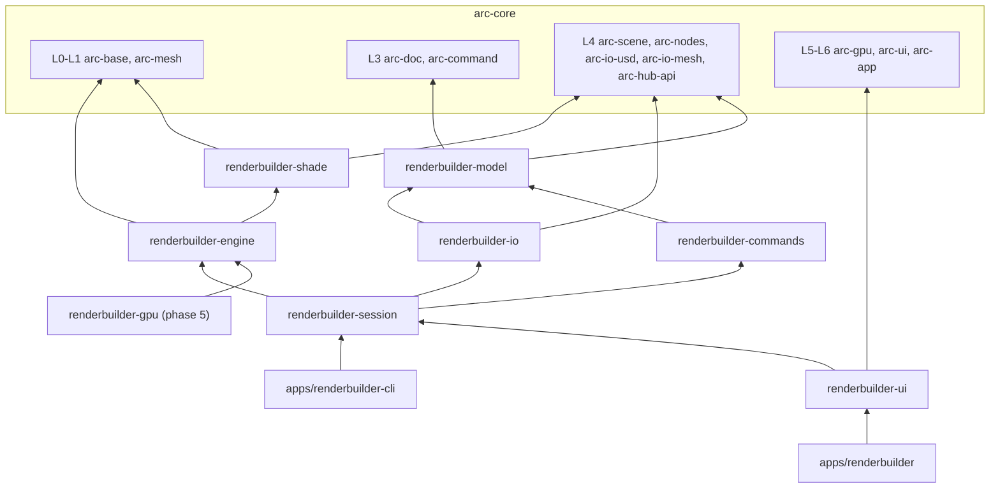

# RenderBuilder

> **Status: design phase.** No builds are available yet. This repository contains the product definition, architecture and roadmap that implementation follows.

RenderBuilder is the physically based production renderer and look-development tool of the Arc
suite. It renders scenes described in OpenUSD, MaterialX, OpenPBR and the Arc Scene contract with a
deterministic unidirectional path tracer, first on the CPU and then on GPUs from any vendor through
wgpu. The same engine serves the RenderBuilder desktop application, the path-traced viewports of
every Arc product, the command-line renderer and render-farm workers, for stills, animation,
panoramas, illuminance and solar studies.

## Who it is for

Architectural visualization artists and architects, lighting and daylight designers, product
designers, look-development and lighting artists, animation and visual-effects artists, and
pipeline engineers who run render farms. See [docs/product/vision.md](docs/product/vision.md).

## Capability areas

| Area | Scope | Specification |
|---|---|---|
| Scene | Render document, scene sources, scene graph, collections, assets, render setups | [01-scene.md](docs/product/capabilities/01-scene.md) |
| Cameras | Projections, optics, exposure, shutter, clipping | [02-camera.md](docs/product/capabilities/02-camera.md) |
| Geometry | Meshes, subdivision, displacement, curves, points, splats, instancing, stand-ins | [03-geometry.md](docs/product/capabilities/03-geometry.md) |
| Volumes | Grid volumes, media, atmosphere, volume shading | [04-volume.md](docs/product/capabilities/04-volume.md) |
| Lights | Light types, units, linking, groups, filters, rigs | [05-light.md](docs/product/capabilities/05-light.md) |
| Surface shading | OpenPBR surface, layering, shadow catcher, glazing | [06-surface.md](docs/product/capabilities/06-surface.md) |
| Hair and stylized shading | Hair and fur, toon, contours, technical illustration | [07-hair-stylized.md](docs/product/capabilities/07-hair-stylized.md) |
| Shading networks | Network model, compilation, utility nodes | [08-shading-nodes.md](docs/product/capabilities/08-shading-nodes.md) |
| Textures | Image textures, texture cache, procedurals, baking | [09-texture.md](docs/product/capabilities/09-texture.md) |
| Light transport | Integrator, many-light sampling, path guiding, determinism, devices, spectral mode | [10-transport.md](docs/product/capabilities/10-transport.md) |
| Adaptive sampling and denoising | Progressive and adaptive sampling, stop conditions, denoising | [11-adaptive-denoise.md](docs/product/capabilities/11-adaptive-denoise.md) |
| Outputs | Output channels, light path expressions, Cryptomatte, deep data, image formats | [12-output.md](docs/product/capabilities/12-output.md) |
| Imagers | Post-processing and light mixer | [13-imager.md](docs/product/capabilities/13-imager.md) |
| Color management | Color configuration, rendering space, display transforms | [14-color.md](docs/product/capabilities/14-color.md) |
| Render view | Interactive rendering, inspection, snapshots, comparison | [15-render-view.md](docs/product/capabilities/15-render-view.md) |
| Look development | Material editor and look-development stage | [16-lookdev.md](docs/product/capabilities/16-lookdev.md) |
| Overrides and looks | Looks, override layers, render passes, variants | [17-overrides.md](docs/product/capabilities/17-overrides.md) |
| Batch and farm | Command-line renderer, distributed rendering, farm worker | [18-batch.md](docs/product/capabilities/18-batch.md) |
| Host integration | Sessions with Arc products through the Arc Scene contract | [19-host.md](docs/product/capabilities/19-host.md) |
| Architectural studies | Daylight, illuminance, solar studies, panoramas, walkthroughs | [20-studies.md](docs/product/capabilities/20-studies.md) |
| Libraries | Material, light and environment libraries | [21-library.md](docs/product/capabilities/21-library.md) |
| Diagnostics | Logging, statistics, profiling, debug views | [22-diagnostics.md](docs/product/capabilities/22-diagnostics.md) |
| Extensibility | Automation, custom shading, sandboxed plug-ins | [23-extensibility.md](docs/product/capabilities/23-extensibility.md) |
| Interoperability | OpenUSD, MaterialX, OpenPBR, OSL, OpenVDB, OpenEXR and more | [24-interop.md](docs/product/capabilities/24-interop.md) |

## How it fits in the suite

- **Arc Scene contract.** Arc products render through RenderBuilder in a separate process: they
  send a scene snapshot and incremental updates, and receive frames over local IPC
  ([docs/architecture/arc-scene-integration.md](docs/architecture/arc-scene-integration.md)).
- **Arc document package.** Render documents (`.renderb`) are Arc document packages referencing
  their scene sources.
- **Hub API.** Farm workers take jobs from the Arc Hub render service and publish results; libraries
  can be shared through Arc Hub.
- **Foundation.** RenderBuilder builds on [`arc-core`](https://github.com/ACKaraca/arc-core) and
  depends on no other Arc product at compile time.

## Architecture at a glance

Details: [docs/architecture/overview.md](docs/architecture/overview.md),
[docs/architecture/integrator.md](docs/architecture/integrator.md).

## Roadmap summary

| Milestone | Suite phase | Goal |
|---|---|---|
| M1 Reference renderer | 4 | Deterministic CPU path tracer and CLI for open-standard scenes |
| M2 Look development and interactive rendering | 4 | Desktop render view, material editor, looks, imagers, libraries |
| M3 Hosts, studies and farm | 4 | Rendering inside Arc products, architectural studies, self-hosted farm |
| M4 GPU device | 5 | Vendor-neutral GPU rendering at parity with the CPU |
| M5 Production depth | 5 | Path guiding, spectral mode, deep output, splats, plug-ins |

See [docs/roadmap.md](docs/roadmap.md).

## Documentation

The documentation map is [docs/README.md](docs/README.md). Decisions are recorded in
[docs/adr/README.md](docs/adr/README.md); terms are defined in [docs/glossary.md](docs/glossary.md).

## Contributing

Read [CONTRIBUTING.md](CONTRIBUTING.md). Automated coding agents follow [AGENTS.md](AGENTS.md).
Security issues are reported as described in [SECURITY.md](SECURITY.md).

## License

Apache License 2.0; see [LICENSE](LICENSE) and [NOTICE](NOTICE).

## Trademarks

Arc, ArchBuilder, DraftBuilder, CivilBuilder, SolidBuilder, MeshBuilder, RenderBuilder, Arc Review and Arc Hub are names of this project and are not covered by the Apache License; see the [trademark policy](https://github.com/ACKaraca/arc-suite/blob/main/TRADEMARKS.md). All other product and company names are trademarks of their respective owners and are used only to describe scope and interoperability.
