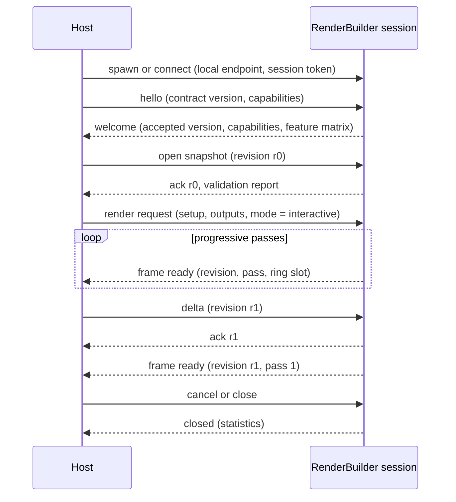

# Arc Scene integration

This document describes RenderBuilder's side of the Arc Scene contract: how host products, host
applications and farm workers drive the renderer through sessions, how scenes are updated incrementally, how frames are
streamed back, and how renderer faults are isolated from hosts. The contract types and protocol are
specified in the `arc-scene` crate of [arc-core](https://github.com/ACKaraca/arc-core); suite
ADR-0010 states why rendering runs out of process.

## Roles

| Role | Who | Responsibility |
|---|---|---|
| Host | ArchBuilder, DraftBuilder (3D), CivilBuilder, SolidBuilder, MeshBuilder, Arc Review, host CLIs | Owns the model; exports the scene as an Arc Scene snapshot and deltas; displays frames. |
| Session server | `renderbuilder-session`, run by `renderbuilder-cli serve`, by the RenderBuilder desktop application, or spawned by a host | Owns the render scene and engine; applies updates; renders; streams frames. |
| Host application | A content-creation application that is not an Arc product, driven through a Hydra render delegate or a connector | Owns its scene; the delegate or connector translates it to snapshots and deltas through the host's public API and displays frames inside the host. |
| Job driver | `renderbuilder-cli worker` and plain CLI renders | Feeds a session from a render package or document instead of a live host. |

A host never links the engine. All communication crosses a process boundary.

## Session lifecycle

1. **Start.** The host spawns `renderbuilder-cli serve` with a per-session endpoint name and a
   random session token, or connects to a running RenderBuilder application that advertises an
   endpoint in the user's runtime directory. Endpoints are local only: named pipes on Windows, Unix
   domain sockets elsewhere (RB-HOST-006).
2. **Handshake.** Host and session exchange contract versions and capability sets (for example
   spectral mode, deep output, GPU device). Same major version always interoperates; optional
   capabilities missing on either side are reported, not fatal (RB-HOST-002).
3. **Snapshot.** The host sends a complete scene at revision r0: prims with stable identifiers,
   materials in the Arc Scene material model, lights, cameras, render settings and semantic
   attributes. Large arrays (positions, indices, textures in memory) travel through shared memory
   blocks referenced from the message, not inline.
4. **Render requests.** A request names a setup (from the host's stored settings or a RenderBuilder
   document), outputs, mode (interactive or final) and resource limits (RB-HOST-007).
5. **Close.** On close the session returns statistics and releases resources. A session also ends
   when its host process exits.

## Incremental updates

- A delta lists operations keyed by stable identifiers: add, modify (only changed fields) and remove
  for prims, materials, lights, cameras and settings. Each delta carries the next revision number.
- The session applies deltas strictly in revision order. A delta with a gap in numbering is held
  until the missing revision arrives; a delta older than the current revision is rejected.
- Deltas are coalesced: if several arrive while a pass is running, they are applied together at the
  next pass boundary, and the resulting scene version carries the highest revision.
- Every frame reports the revision it was rendered from. The host discards frames older than its
  latest sent revision, and the session stops writing frames for superseded revisions as soon as a
  newer revision is applied (RB-HOST-003).
- Change classes follow the regeneration rules in
  [domain-model.md](domain-model.md#regeneration-rules), so a material value change does not
  rebuild geometry and an imager change does not restart sampling.

## Frame streaming over local IPC

- Frames are written into a shared-memory ring of image slots created by the session and mapped by
  the host. Each slot holds a header (revision, pass, samples, dimensions, outputs, checksum) and the
  pixel data of the requested outputs.
- The control channel carries only "frame ready" notifications with a slot index. The host reads
  the slot and releases it; the session never overwrites a slot the host has not released, and it
  skips intermediate passes when the host reads slowly, so the host always gets the newest frame
  (RB-HOST-004).
- Interactive frames are display-referred or scene-referred as the host requests; final renders
  also write files and return an image asset for the host document (RB-HOST-009).
- Region updates send only the changed rectangle when the host enables it, reducing copying for
  region refinement.

## Crash isolation and recovery

- A renderer fault terminates only the session process. The host detects it from the closed
  control channel or process exit, shows an error with the session's last log lines, and offers a
  restart (RB-HOST-005).
- The host keeps its last snapshot and every delta not yet acknowledged; on restart it resends the
  snapshot and the deltas in order, so the new session reaches the same revision.
- The session writes a crash report (RB-DIAG-012) with the scene digest so the fault can be
  reproduced from a render package.
- Resource exhaustion is reported as an error message, not a crash, whenever the session can detect
  it in time (RB-DIAG-011).
- Hostile-input discipline applies to every message: counts, sizes and nesting are bounded and
  validated before allocation; malformed messages close the session with an error.

## Host applications

A Hydra render delegate and host connectors (RB-HOSTAPP-001, RB-HOSTAPP-006) are session clients
that run inside another application. They use the lifecycle above unchanged and contain no engine
([ADR 0007](../adr/0007-delegate-and-connectors-without-the-engine.md)); the delegate is loaded by
any Hydra-capable host, a connector by the one application it is written for, through that
application's public API only.

| Host event | Contract operation |
|---|---|
| Scene opened, or the delegate is selected as the renderer | Spawn or connect, handshake, snapshot (RB-HOSTAPP-003, RB-HOSTAPP-007) |
| Host change notification (Hydra change tracking, or the host's own change events) | Delta keyed by stable identifier, coalesced per pass (RB-HOSTAPP-011) |
| Host material, light, camera or render-settings change | Material, light, camera or settings delta (RB-HOSTAPP-008 to 010) |
| Render view shown, hidden or resized | Render request, cancel, or region update (RB-HOSTAPP-012) |
| Host command-line or batch export | Render package export or a headless render request (RB-HOSTAPP-014) |
| Host closes the scene or exits | Close; the session also ends when the host process exits |

- **Identity.** Stable identifiers derive from the host's persistent element identifiers, or from
  the Hydra prim path, so looks and overrides survive reloads.
- **Translation limits.** What a connector can read is bounded by the host's public API. Anything it
  cannot express is listed in a loss report (RB-HOSTAPP-016) and replaced by a placeholder, never
  approximated silently. Connector and session exchange capability sets (RB-HOSTAPP-015).
- **Fault handling.** A session fault closes the control channel; the delegate or connector shows the
  error and restarts the session from its last snapshot and unacknowledged deltas, as for any host.
  A fault in the connector itself is limited by keeping the connector small and engine free.
- **Security.** Connectors open no network port and use the same local endpoint and token as any
  host (RB-HOSTAPP-017).

## Farm workers

Farm workers use the same session code without a live host. The worker downloads a render package
into its content-addressed cache, verifies digests (RB-BATCH-017), opens it as a snapshot, issues
final render requests per frame packet, and uploads outputs to Arc Hub (RB-BATCH-015). Because the
same session code drives hosts and workers, a render configured interactively in a host renders
identically on the farm.

## Security

- No session listens on a network interface. Remote rendering is requested through Arc Hub, whose
  workers pull jobs; nothing pushes scenes to a workstation over the network.
- Endpoints are created with permissions restricting access to the current user, and every
  connection must present the session token.
- Shared-memory blocks are created per session with the same restrictions and released on close.
