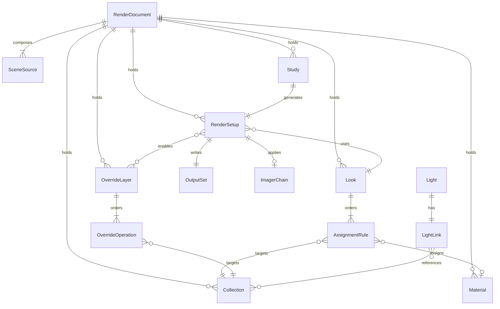
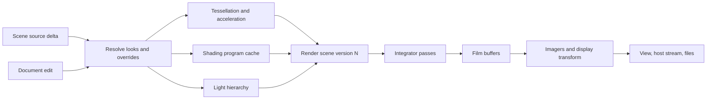

# Domain model

This document defines the object types of a RenderBuilder document and of the render scene derived
from it, their relationships, invariants, identity rules and what recomputes when something
changes.

## Two models

- The **render document** (`.renderb`, stored by `arc-doc`) is the authority for everything
  RenderBuilder authors: setups, looks, overrides, lights it adds, studies, snapshots.
- The **render scene** (in `renderbuilder-engine`) is derived. It is built from the scene sources
  plus the document's looks and overrides, and can be rebuilt at any time. It is never saved,
  except as a flattened copy inside a render package.

## Document object types

| Type | Key properties | Notes |
|---|---|---|
| `RenderDocument` | id, schema version, frame rate, frame range, active setup, color configuration reference, search paths, geolocation reference | One per file. |
| `SceneSource` | id, kind (`ArcScenePackage`, `HostSession`, `UsdStage`, `RenderPackage`), location, content digest, resolved revision, order, status (`Resolved`, `Missing`, `Stale`) | Ordered list; order defines composition precedence. |
| `Collection` | id, name, explicit members (stable prim identities), selector expression (optional) | Membership = explicit ∪ expression matches. |
| `Material` | id, name, shading network (graph of `Node` and `Connection`), exposed parameters, variants, library link (optional) | The network is stored as MaterialX-compatible graph data. |
| `Node` | id, node definition id and version, input values, position | Belongs to exactly one material or node group. |
| `NodeGroup` | id, name, version, subgraph, interface | Usable as a node definition. |
| `Look` | id, name, ordered list of `AssignmentRule` | |
| `AssignmentRule` | id, target collection, material (optional), displacement (optional), attribute values, material variant | |
| `OverrideLayer` | id, name, ordered list of `OverrideOperation` | |
| `OverrideOperation` | id, kind (`Disable`, `Enable`, `SetParameter`, `ScaleParameter`, `SetTransform`, `OffsetTransform`, `MaterialOverride`, `SetVariant`), target collection, parameter path, value, exceptions collection | |
| `Light` | id, kind, transform, parent prim (optional), intensity and unit, color, temperature, exposure, shape parameters, profile reference, filters, group, links, visibility flags, labels | Lights authored in the document; source lights are prims. |
| `LightFilter` | id, kind, parameters | Shared by reference between lights. |
| `LightLink` | light, illumination include and exclude collections, shadow collection | One per light; default is all. |
| `Camera` | id, projection kind and parameters, lens, exposure, shutter, clipping planes | Document cameras; source cameras are prims. |
| `RenderSetup` | id, name, camera reference(s), resolution, pixel aspect, region, frame range override, look, enabled override layers, light states, sampling settings, transport settings, output set, imager chain, device and fallback policy, missing asset policy, passes | |
| `OutputSet` | id, list of `RenderOutput`, list of file targets | |
| `RenderOutput` | id, name, source (built-in channel, light path expression, custom channel, light group), data type, pixel filter, file target, layer name, color space | |
| `ImagerChain` | id, ordered imagers, target outputs | |
| `Study` | id, kind (`Illuminance`, `Luminance`, `DaylightFactor`, `SolarSequence`, `SunHours`, `PanoramaSet`, `Walkthrough`), site parameters, time parameters, sensor grids, legend, scenario | Renders through a generated setup. |
| `SensorGrid` | id, source (surface, work plane, host room), height, spacing, generated sample points | Points regenerate from their source. |
| `Snapshot` | id, image asset, settings digest, document revision, note, timestamp | Image stored as a content-addressed asset. |
| `LibraryLink` | library id, item id, version, digest, mode (`Linked`, `Copied`) | |

## Render scene object types

| Type | Key properties |
|---|---|
| `Prim` | stable identity, path, kind, parent, local transform samples, attributes, render attributes (visibility flags, sidedness, holdout, shadow flags), labels |
| `Mesh` / `SubdivMesh` | topology, positions samples, normals, UV sets, face material indices, creases, tessellation settings |
| `Curves` | basis, vertex counts, positions samples, widths, render mode, attributes |
| `Points` / `SplatSet` | positions, radii or covariances, opacity, color or harmonics, mode |
| `Volume` | grids, transform, medium priority |
| `StandIn` | file reference, bounds, load policy, load state |
| `Instancer` | prototypes, per-instance transforms, identifiers, attributes |
| `ResolvedMaterial` | material id, variant, bound parameter values, compiled `ShadingProgram` reference |
| `ShadingProgram` | network hash, IR, feature set, compiled device artifacts |
| `ResolvedLight` | light parameters after overrides and setup light states, membership in the light hierarchy |
| `Film` | resolution, data window, outputs with accumulation buffers, sample counts, convergence state |



## Identity rules

- Document objects have 128-bit stable identifiers from `arc-doc`. Names are labels and need not be
  unique.
- Prims are identified by the identity given by their source: the Arc object identifier for Arc
  Scene sources and host sessions, the prim path for OpenUSD stages. The pair (source id, source
  identity) is the prim's stable identity in the document.
- Rules, links and Cryptomatte names refer to stable identities or to collections, never to
  in-memory handles.
- When a source renames or moves a prim and keeps its identity (Arc sources), assignments follow
  it. When identity changes (an OpenUSD path change), assignments become orphaned and are reported
  (RB-SCENE-004).
- Shading programs are identified by the hash of their network and node definition versions, so
  identical networks share one compiled program.

## Selector expressions

```
expr      := term ( ("or" | "and") term )*
term      := "not" term | "(" expr ")" | path | predicate | "kind:" name | "material:" name | "in:" collection
path      := "/" segment ( "/" segment )*     segment: name with "*" (one level) or "**" (any depth)
predicate := "[" "@" attribute op value "]"   op: == != < <= > >= ~= (glob match)
```

Expressions are parsed on edit; errors carry the character position. Evaluation is incremental:
when a delta touches prims, only those prims are re-tested.

## Invariants

1. A render scene is a pure function of (scene sources at their resolved revisions, document
   state, setup, RenderBuilder version). Nothing else influences an image.
2. Looks and overrides never write into scene sources; removing every look and override layer
   restores the source appearance.
3. Assignment order is total: within a look, later rules win per attribute; override layers apply
   after the look in setup order; setup light states apply last.
4. A material network is acyclic and type-correct before it compiles; an invalid network renders
   with the diagnostic material and a validation error.
5. Every frame carries the document revision and source revisions it was rendered from; a frame
   older than the latest applied revision is never displayed or written as current.
6. In physically valid mode, no override or light parameter outside physical ranges is active;
   validation fails otherwise.
7. Output file names are unique within a setup render; two outputs targeting the same file must
   target different layers or parts.
8. A render package contains every dependency listed by the dependency listing, each with a
   verified digest.

## Regeneration rules

| Change | Recomputed | Sampling |
|---|---|---|
| Source delta: transform | Instance transforms, top-level acceleration structure refit | Restart |
| Source delta: topology or positions | Prim tessellation, its bottom-level structure, top-level refit | Restart |
| Material parameter (value only) | Parameter block of the compiled program | Restart |
| Material network structure | Program recompilation for that network hash only | Restart |
| Look or override rule | Affected prims' resolved materials and attributes | Restart |
| Collection expression | Membership, then all rules using the collection | Restart if membership changed |
| Light parameter | Light hierarchy node and bounds | Restart |
| Camera | Camera only | Restart |
| Sampling stop conditions (max samples, threshold, time) | Nothing | Continue |
| Imager or display transform | Imager chain on accumulated buffers | Continue (no resampling) |
| Light mixer values | Recombination of light group buffers | Continue |
| Output added or removed | Film layout | Restart |
| Texture file changed on disk | Cache entries of that file, dependent conversions | Restart |
| Color configuration | All color conversions, texture conversion keys | Restart |


