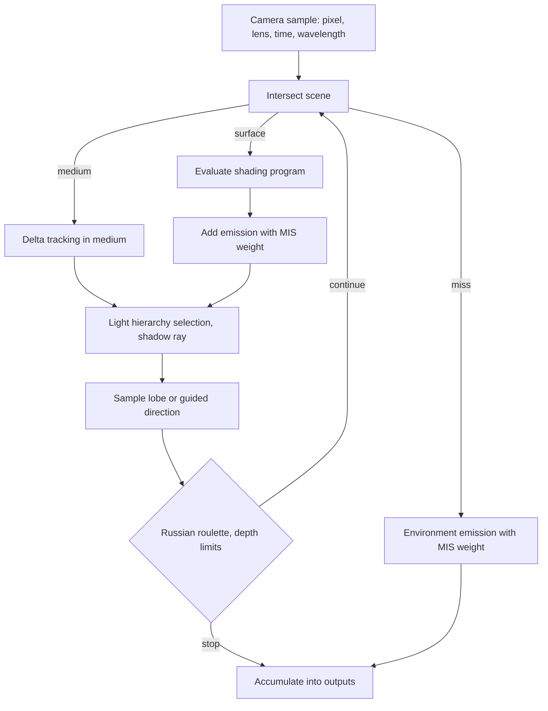

# Integrator design

This document describes RenderBuilder's light-transport design: how paths are constructed and
sampled, how lights are selected, how path guiding and adaptive sampling work, how sampling
patterns make renders deterministic, and how the CPU reference integrator and the wgpu GPU
integrator are held to parity.

## Goals

1. Unbiased by default; every source of bias (clamps, depth limits, roughness regularization) is an
   explicit setting recorded in output metadata.
2. Predictable noise that decreases with samples, without per-scene precomputation.
3. Bit-identical results on a platform for identical inputs, independent of scheduling.
4. One algorithm, two devices: the GPU device implements the same estimator with the same sample
   dimensions so images converge to the same result.

## Path construction

A camera sample selects a pixel position (filtered by importance-sampling the pixel filter), a lens
position, a time in the shutter and, in spectral mode, a hero wavelength. The path then iterates:

1. **Intersect** the two-level acceleration structure. Stand-ins whose bounds are hit for the first
   time are queued for loading; the pass that triggered loading treats them as transparent until the
   next pass, so loading never changes the result of a completed pass.
2. **Medium interaction.** If the ray travels through a medium, distance sampling uses delta
   tracking against piecewise majorants stored per grid brick; transmittance for shadow rays uses
   ratio tracking. Media nest by priority (RB-VOL-007).
3. **Surface interaction.** The shading program evaluates the material into a closure tree;
   stochastic opacity decides presence (RB-PATH-003).
4. **Emission.** Emission hit by the path is added with the multiple importance sampling weight
   computed from the light-selection probability of the hit emitter.
5. **Next-event estimation.** A light is chosen from the light hierarchy, a point on it sampled, and
   a shadow ray traced with transmittance through media and transparent surfaces. The contribution is
   weighted by the power heuristic against the material sampling probability.
6. **Material sampling.** A lobe is chosen in proportion to its estimated albedo, a direction sampled
   (or a guided direction, see below), and throughput updated.
7. **Termination.** After the minimum depth, Russian roulette continues the path with probability
   tied to throughput; per-type depth limits terminate paths that exceed them (RB-PATH-002).
8. **Labeling.** Each event appends a symbol to the light path expression automata of the outputs
   that use them; contributions are routed to the outputs whose automaton accepts the path.

### Ray offsets

Secondary rays start at positions offset along the geometric normal by a bound derived from the
floating-point error of the intersection computation (RB-GEOM-028). There is no user bias setting.
Geometry is transformed camera-relative before conversion to single precision (RB-GEOM-027).

## Multiple importance sampling

- Direct lighting combines light sampling and material sampling with the power heuristic
  (exponent 2).
- Environment lights combine luminance-based importance sampling (and portal sampling, RB-LIGHT-011)
  with material sampling.
- Emission found by material sampling uses the probability the light hierarchy would have assigned
  to that emitter from the previous vertex, so both strategies are weighted consistently even with
  many lights.
- Delta lobes (perfect mirrors and thin-walled glass) and delta lights bypass weighting.

## Many-light sampling

All lights, including emissive meshes above the power threshold (RB-LIGHT-012) and instanced
emitters, are stored in a bounding volume hierarchy whose nodes carry total power, spatial bounds
and an orientation cone. At a shading point, traversal descends stochastically, choosing children
in proportion to an importance estimate built from power, distance and the angle between the cone
and the shading point's normal hemisphere. The selection probability is the product of the choices,
which the multiple importance sampling weights reuse. Cost is logarithmic in the number of lights
(RB-PATH-006). Light linking is applied during traversal by masking subtrees whose lights are all
excluded for the shading point's prim, so linked scenes do not waste samples on excluded lights.
Per-light importance weights (RB-PATH-009) scale node importance without changing emitted power.

## Path guiding

Path guiding (RB-PATH-010) learns where light comes from:

- Space is partitioned adaptively into regions; each region holds a directional distribution
  (the method is chosen under OQ-12) fitted to radiance samples recorded by earlier passes.
- At diffuse and glossy vertices, the direction is drawn from a mixture of the guiding distribution
  and the material lobe, with the mixture probability set per region from its training quality.
  The combined probability is used for multiple importance sampling, so guiding never introduces
  bias.
- Training happens between passes. Samples are collected into per-thread buffers and merged in
  pixel order before fitting, so the trained structure depends only on the samples, not on thread
  timing (RB-PATH-012).
- Guided light selection (RB-PATH-011) stores, per region, a correction to the light hierarchy's
  importance estimate learned from unoccluded contributions.
- Memory is bounded by a region budget; when exceeded, the least informative regions merge.

## Adaptive sampling

The film keeps, for the convergence output (beauty by default), two accumulation buffers fed by
alternating sample indices. Per-pixel error is estimated from their difference after applying the
view transform, so the threshold corresponds to visible noise (RB-NOISE-002). Error is filtered over
a small neighborhood so isolated fireflies do not stop or restart regions incorrectly. A pixel stops
when its error falls below the threshold after the minimum sample count; pixels whose neighbors are
still active continue to avoid visible tile boundaries. The decision is evaluated at pass
boundaries only, so the set of samples taken by each pixel is a deterministic function of the
previous passes.

## Sampling patterns

- Each pixel draws its samples from an Owen-scrambled Sobol sequence. The scramble seed is a hash
  of the pixel coordinates and the setup seed (by default combined with the frame number,
  RB-PATH-014).
- Dimensions are allocated by a fixed table: camera (pixel, lens, time, wavelength) first, then per
  bounce a fixed block (light selection, light position, lobe selection, direction, roulette,
  medium distance). The GPU device uses the same table.
- For low sample counts, sample indices are permuted per pixel with a precomputed blue-noise
  ordering so that error appears as high-frequency noise, which denoises better (RB-PATH-013).
- Sample index ranges are what distributed rendering splits: sample-split rendering assigns
  disjoint index ranges to machines (RB-BATCH-013); tile-split rendering assigns disjoint pixels
  (RB-BATCH-012).

## Determinism and reproducibility

The rendered value of a pixel is a pure function of the render scene, the setup, the pixel and its
sample index range. This holds because:

1. Random numbers are never drawn from shared generators; every decision uses the pixel's sequence
   at a fixed dimension.
2. Accumulation is per pixel in sample-index order. Tiles write disjoint pixels, so thread count,
   tile size and tile order cannot change sums.
3. Reductions across pixels (guiding training, statistics, adaptive decisions) gather data in pixel
   order before reducing.
4. Floating-point code is compiled without value-changing optimizations; fused multiply-add usage
   is fixed per target. Transcendental functions use the engine's own implementations rather than
   platform libraries whose results can vary.
5. Checkpoints store accumulated buffers and the next sample index per pixel, so a resumed render
   continues exactly where it stopped (RB-NOISE-007).
6. Stand-in loading and texture conversion results take effect at pass boundaries.

Bit-identical results are guaranteed per platform (operating system, CPU architecture and
RenderBuilder build). Whether this can be extended across platforms is open (OQ-14); across
platforms, equality is verified statistically.

## Spectral mode

In spectral mode (RB-PATH-024) a camera sample selects a hero wavelength and three additional
equally spaced wavelengths. RGB inputs are upsampled to smooth spectra from their source color
space; spectral inputs are used directly (RB-PATH-025). Dispersion and thin-film interference are
evaluated per wavelength; at dispersive interfaces the secondary wavelengths terminate and the path
continues with the hero wavelength. Results are converted to the rendering space with the CIE
observer, so outputs, imagers and color management are identical in both modes.

## CPU and GPU parity

The CPU integrator (RB-PATH-018) is the reference. The GPU integrator (RB-PATH-019) runs on wgpu
as a wavefront pipeline: ray generation, intersection (hardware ray queries where the adapter
supports them, compute traversal of the shared acceleration-structure layout otherwise), material
evaluation sorted by shading program, light sampling, shadow rays and accumulation, each as a
compute stage over queues of path states.

Parity is held by construction and by testing:

- **Same inputs.** Both devices consume the same render scene, the same acceleration-structure
  layout (ADR 0003) and the same shading program, translated to WGSL from the IR the CPU interprets
  (ADR 0002).
- **Same estimator.** Both use the same sampling dimension table, light hierarchy, multiple
  importance sampling weights and roulette rule. Differences are limited to floating-point
  evaluation order, so images converge to the same expected value but are not bit-identical.
- **Declared feature matrix.** Each device declares the IR features and scene features it supports.
  Validation compares a scene against the selected device's matrix; unsupported features fail
  validation or trigger the setup's CPU fallback (RB-PATH-020). There is no silent substitution.
- **Image-comparison tests.** Every scene of the parity corpus that the GPU supports is rendered on
  both devices at high sample counts with fixed seeds. For each output and pixel, the difference of
  means is compared with the combined standard error from each device's variance buffers; the test
  fails when the fraction of pixels outside the confidence interval exceeds the expected rate, or
  when a perceptual difference metric of the denoised images exceeds its threshold. Tests run on
  adapters from several vendors in continuous integration and gate GPU changes.
- **Parity report.** Users run the same comparison on their own scenes with the CLI
  (RB-PATH-021).
- **Feature ladder.** A feature is enabled on the GPU device only after its corpus scenes pass;
  the feature matrix is generated from the same declarations, so documentation cannot drift from
  behavior.
