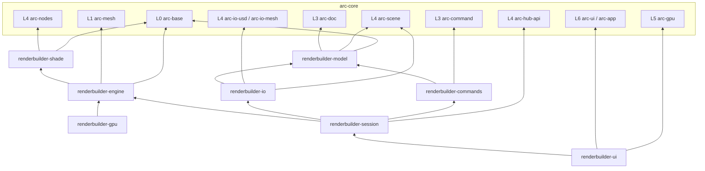

# Architecture overview

This document describes the crates of RenderBuilder, how they use `arc-core`, the main runtime
flows, threading, performance targets, the automation surface and the testing strategy.
Suite-wide decisions are in the [suite ADRs](https://github.com/ACKaraca/arc-suite/tree/main/docs/adr);
product decisions are in [../adr/README.md](../adr/README.md).

## Crates

RenderBuilder follows the suite product template and adds crates only where a second consumer
exists.

| Crate | Layer role | Responsibility |
|---|---|---|
| `renderbuilder-model` | Domain (headless) | Render document objects: scene source references, render setups, looks, override layers, collections, studies, snapshots, library links. Evaluation of looks and overrides into a resolved scene description. |
| `renderbuilder-commands` | Domain (headless) | User-level commands on the model: edit setups, assign looks, add lights, run studies, package, render. |
| `renderbuilder-io` | Domain (headless) | Mapping from Arc Scene, OpenUSD, MaterialX, glTF, PLY, OBJ, OpenVDB and photometric files into the render scene; render package read and write; loss reports. |
| `renderbuilder-shade` | Engine (headless) | Shading network compilation: MaterialX and OSL translation into the shading program representation, OpenPBR closure model, constant folding, program cache. Consumed by the CPU and GPU devices. |
| `renderbuilder-engine` | Engine (headless) | Render scene, acceleration structures, tessellation, texture cache, CPU reference integrator, film and outputs, imagers, denoiser integration, statistics. |
| `renderbuilder-gpu` | Engine (headless, GPU) | wgpu device: scene upload, ray traversal, wavefront integrator, shading program code generation to WGSL. Optional; phase 5. |
| `renderbuilder-session` | Service (headless) | Session server for the Arc Scene contract: IPC, snapshot and delta application, frame streaming, render requests, job runner for farm workers. |
| `renderbuilder-ui` | UI | Render view, node editor panels, look and override editors, light mixer, study panels, library browser. |
| `renderbuilder-oidn-sys` | FFI | The only crate allowed `unsafe` for Open Image Denoise (ADR 0005). |
| `renderbuilder-ocio-sys` | FFI | The only crate allowed `unsafe` for OpenColorIO (ADR 0005). |

| Application | Responsibility |
|---|---|
| `apps/renderbuilder` | Desktop application: wiring of `arc-app`, `renderbuilder-ui` and a local session. |
| `apps/renderbuilder-cli` | Headless CLI: `render`, `validate`, `package`, `deps`, `texture`, `denoise`, `merge`, `parity`, `serve` (automation protocol and session endpoint) and `worker` (farm worker). |

The engine, shade and session crates never depend on windowing or UI crates and build headless for
the CLI, farm workers and tests. `renderbuilder-gpu` depends on wgpu for compute only and opens no
window.

## Use of arc-core

| Crate | Used for |
|---|---|
| `arc-base` | Identifiers, units (photometric quantities, lengths), tolerances, color types, error types. |
| `arc-mesh` | Mesh topology, subdivision rules and limit evaluation used by adaptive tessellation. |
| `arc-doc` | The `.renderb` document store, transactions, journal, undo, recovery, external references to scene sources. |
| `arc-command` | Command registry, automation protocol endpoint, headless runner. |
| `arc-scene` | The Arc Scene contract types, material model and session protocol definitions. |
| `arc-nodes` | Graph data model and serialization for shading networks and render job graphs; the node editor widget comes from `arc-ui`. |
| `arc-io-usd`, `arc-io-mesh`, `arc-io-geo` | Neutral models of OpenUSD, glTF, OBJ, PLY and coordinate reference records; `renderbuilder-io` owns the mapping. |
| `arc-hub-api` | Farm worker job protocol, publishing results and libraries. |
| `arc-gpu` | Displaying frames, overlays and the real-time preview of the scene in the desktop application. |
| `arc-ui`, `arc-app` | Docking workspace, property grid, node editor, localization, settings, crash reporting. |

## Runtime flows

### Edit to image

1. A user action or protocol call runs a command (`arc-command`).
2. The command changes the render document inside a transaction (`arc-doc`) and the journal records
   it.
3. The model evaluates the change: looks, override layers and collections recompute only for the
   affected prims, producing a resolved scene delta tagged with the document revision.
4. The session applies the delta to the render scene: geometry rebuilds or refits acceleration
   structures, materials recompile only when their network hash changes, lights update the light
   hierarchy.
5. The engine restarts or continues sampling according to the change class (see
   [domain-model.md](domain-model.md#regeneration-rules)).
6. Frames flow to the render view, a host viewport or files; a frame from an older revision is
   never shown after a newer delta has been applied.

### Host rendering

Hosts drive the same session through the Arc Scene contract; see
[arc-scene-integration.md](arc-scene-integration.md).

### Batch and farm

The CLI and the worker load a document, package or stage into a session without UI, render frame
packets and write outputs atomically. The worker obtains jobs from Arc Hub and publishes results
there.

## Product-specific subsystems

| Subsystem | Location | Notes |
|---|---|---|
| Integrator | `renderbuilder-engine` | Design in [integrator.md](integrator.md). |
| Shading program | `renderbuilder-shade` | A typed, SSA-form intermediate representation of shading networks with closure outputs; interpreted with vectorized evaluation on the CPU and translated to WGSL on the GPU (ADR 0002). |
| Acceleration structures | `renderbuilder-engine` | Two-level bounding volume hierarchies (instances over prototypes) built in Rust, with a layout shared by the CPU and GPU devices (ADR 0003). |
| Tessellation | `renderbuilder-engine` | Adaptive, crack-free tessellation of subdivision and displaced surfaces, cached per prim and dicing camera. |
| Texture cache | `renderbuilder-engine` | Tiled mip-mapped cache with a memory budget, background conversion and a content-addressed on-disk store. |
| Film and outputs | `renderbuilder-engine` | Per-output accumulation buffers, pixel filters, light path expression automata, Cryptomatte ranking, deep sample lists, file writers. |
| Studies | `renderbuilder-model`, `renderbuilder-engine` | Sun position, sky models, sensor grids evaluated as irradiance probes by the same integrator. |
| Session server | `renderbuilder-session` | IPC, shared-memory frame ring, revision ordering, restart and replay. |

## Threading and background work

- The CPU integrator runs on a work-stealing thread pool. Work is divided into tiles of pixels;
  each pixel's samples derive from its own sequence index, so results do not depend on scheduling.
- Scene updates are applied on a session thread between sample passes; the integrator never reads
  a scene that is being modified (passes run on an immutable scene version).
- Texture conversion, thumbnail rendering, acceleration-structure builds of newly loaded stand-ins
  and file writing run as cancellable background tasks tagged with the revision they belong to
  (suite ADR-0007).
- The UI thread never waits on rendering; it reads the latest completed frame from the frame ring.
- Host sessions run in their own process; a host thread waiting on IPC never blocks its UI.

## Performance targets

Targets are acceptance budgets on the reference workstation profile defined in the test corpus;
they are not measurements.

| Target | Value | Rationale |
|---|---|---|
| First updated pixels after a material parameter edit | under 100 ms | Look development depends on immediate feedback. |
| First pixels after a host snapshot of 1 million triangles | under 1 s | Switching a host viewport to path tracing must feel like changing a display mode. |
| Acceleration structure refit after a transform edit | under 50 ms for 10,000 instances | Interactive layout changes in architectural scenes. |
| Per-instance memory | at most 128 bytes | Hundreds of millions of instances (vegetation, entourage) must fit in workstation memory. |
| Default texture cache budget | 25 percent of physical memory | Leaves room for geometry while keeping texture thrashing rare. |
| Determinism | zero differing pixels across thread counts | Required by RB-PATH-015, distributed merges and regression tests. |
| CPU scaling | at least 90 percent efficiency from 1 to 64 threads on the corpus | Workstations and farm nodes have many cores. |

## Automation surface

- **Commands**: every operation is an Arc command (RB-EXT-001), reachable from menus, the command
  line and palette, macros and the automation protocol.
- **Automation protocol**: served by the desktop application and by `renderbuilder-cli serve`;
  the official Python client is a protocol client (RB-EXT-002).
- **CLI**: the commands listed above, with JSON-lines progress and documented exit codes
  (RB-BATCH-004).
- **Node graphs**: render job graphs on `arc-nodes` (RB-EXT-004).
- **Plug-ins**: sandboxed WebAssembly plug-ins for procedurals, imagers, writers and scene readers
  (RB-EXT-007); shading extensions are MaterialX node definitions or OSL, so they run on every
  device.

## Testing strategy

| Test kind | What it proves |
|---|---|
| Unit tests | Sampling functions, closures, color conversions, selector parsing, light path expression automata. |
| Furnace and analytical tests | Energy conservation per lobe combination (RB-SURF-011); illuminance against analytical solutions (RB-STUDY-010). |
| Image regression corpus | Each capability area has scenes rendered at fixed seeds; CPU images are compared bit for bit with the stored reference for the same platform, and statistically across platforms. |
| Determinism tests | Renders with 1, 7 and all threads, with different tile sizes, and interrupted and resumed, produce identical hashes. |
| Device parity tests | Every corpus scene supported by the GPU feature matrix passes the statistical parity test against the CPU reference (see [integrator.md](integrator.md#cpu-and-gpu-parity)). |
| Interchange tests | OpenUSD and MaterialX imports compare with reference renders; written files pass the projects' validators (RB-IO-014). |
| Session tests | Scripted hosts send snapshots and deltas, kill the renderer mid-frame and verify replay and revision ordering. |
| Fuzzing | Every importer, the package reader and the session protocol decoder are fuzzed. |
| Performance tests | The targets above run nightly; regressions beyond 5 percent fail the nightly job. |
